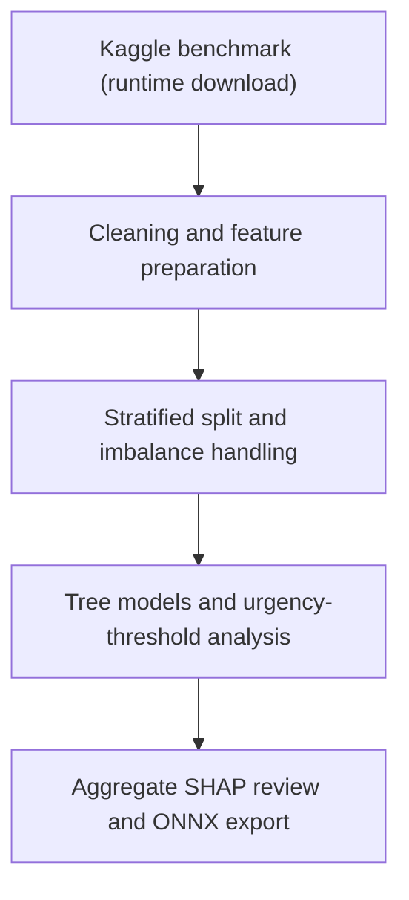

# QuickTriage — Emergency Triage ML Prototype

QuickTriage is an academic machine-learning prototype that explores how emergency-triage data can be transformed into a **three-level urgency classification** and an interoperable model artifact.

> **Research prototype only.** It is not a diagnostic system and must not be used to make real patient-care decisions.

## Project goals

- Build a reproducible tabular ML workflow around the public *Emergency Service Triage Application* benchmark on Kaggle.
- Prepare demographic and vital-sign features and group KTAS labels into three urgency levels.
- Compare tree-based classifiers, address class imbalance during training, and explore a decision threshold that prioritizes recall for the most urgent class.
- Explain model behavior with aggregate SHAP visualizations and export an inference model to ONNX.

## Workflow

## Repository contents

- `notebooks/QuickTriage_clean.ipynb` — curated notebook with execution outputs removed.
- `README.md` — project overview, workflow, setup notes, and responsible-use limits.

The project report, diagrams, and figures are maintained separately in [quicktriage-rapport](https://github.com/Salaheddine03-ux/quicktriage-rapport).

## Data and privacy

The notebook downloads the benchmark at runtime using Kaggle. **No patient-level CSV, notebook output, credential file, or trained model artifact is committed here.** Configure Kaggle credentials only in your local/Colab runtime; never upload `kaggle.json` or tokens to GitHub. Follow the dataset's terms and review its de-identification and use conditions before running the notebook.

## Run the notebook

1. Open `notebooks/QuickTriage_clean.ipynb` in Jupyter or Google Colab.
2. Install the pinned packages in the first setup cell.
3. Provide Kaggle credentials through the runtime's secure file upload, or supply the permitted CSV locally.
4. Run the cells in order and review the resulting evaluation and SHAP plots.

Python packages used include pandas, NumPy, scikit-learn, imbalanced-learn, XGBoost, SHAP, and ONNX tooling. The notebook contains the version pins and data-download instructions.

## Responsible use and limitations

- The source dataset is a small public benchmark; its population and collection context may not generalize to other hospitals or patients.
- The notebook is an educational experiment. It does not establish clinical validity, calibration, fairness, or prospective performance.
- Class grouping and threshold selection can change the balance between missed urgent cases and unnecessary escalation. Such choices require clinical governance and external validation.
- SHAP describes model associations; it does not explain clinical causality.
- FastAPI/Flutter integration is discussed as a possible next step, but a production inference service is not included in this repository.

## Project status

The notebook documents a modeling and ONNX-export workflow. The repository intentionally excludes trained artifacts and individual-level outputs so the public version stays reviewable and privacy-conscious.
